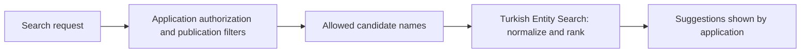

# Turkish Entity Search

**Turkish-aware name matching for search, suggestions and partner discovery.**

Small, predictable TypeScript utilities for handling Turkish letter variants, spacing differences, common typos and phrases such as **“Fortinet Türkiye partnerleri”**. Designed for applications that already have an authorized list of searchable names.

[](https://github.com/Nebride69/partnermap-search-core/actions/workflows/ci.yml)
[](https://github.com/Nebride69/partnermap-search-core/releases)
[](LICENSE)
[](package.json)

**[Türkçe dokümantasyon](README.tr.md)** · [Quick start](#quick-start) · [Live examples](#verified-first-party-use) · [Examples & recipes](docs/EXAMPLES.md) · [Contribute](CONTRIBUTING.md) · [Security](SECURITY.md)

---

## Why this exists

Turkish-language directory search breaks when a query uses a different spelling or is slightly misspelled:

| User types | Reference name | Library behavior |
| --- | --- | --- |
| `paloalto` | `Palo Alto Networks` | Spacing-insensitive prefix match |
| `fortnet` | `Fortinet` | Conservative one-edit suggestion |
| `İŞ ÇÖZÜMLERİ` | `İş Çözümleri` | Turkish-aware normalization |
| `Cisco bayileri?` | `Cisco` | Partner/reseller intent extraction |
| `EDR` | `EDR Solutions` | No fuzzy typo rescue for short query |

**The library suggests and ranks names; it does not search your database or grant access to records.** The calling application is responsible for authorization, publication filters and rate limiting.

## Quick start

**Requirements:** Node.js 20+ · TypeScript is a development dependency · **zero runtime dependencies**.

The library is currently distributed as **source on GitHub**, not as an npm package.

```bash
git clone https://github.com/Nebride69/partnermap-search-core.git
cd partnermap-search-core
npm install
npm test
npm run example
```

After building, use the generated `dist/index.js`:

```js
import { compactSearchName, rankNames, parsePartnerIntent } from './dist/index.js';

const query = 'Palo Alto Türkiye partnerleri';
const { lookupQuery } = parsePartnerIntent(query);

const publishedAndAuthorized = [
  { name: 'Palo Alto Networks' },
  { name: 'Cisco' }
];

const suggestions = rankNames(
  lookupQuery,
  publishedAndAuthorized,
  item => item.name
);

console.log(compactSearchName('Palo Alto')); // "paloalto"
console.log(suggestions[0]?.item.name); // "Palo Alto Networks"
```

For more copyable recipes, see **[Examples & recipes](docs/EXAMPLES.md)**.

> **Package status:** The name `@partnermap/turkish-entity-search` appears in `package.json`, but **no npm publication is claimed**. Do not attempt to install it from npm until a separate release is announced.

## What is included?

| Public API | Purpose |
| --- | --- |
| `compactSearchName(name)` | Turkish-aware casing and Unicode normalization for name comparison |
| `findNameRescueEvidence(name, query)` | Exact, prefix and bounded typo-match evidence |
| `rankNames(query, candidates, getName, limit?)` | Rank **caller-provided, authorized** candidates |
| `parsePartnerIntent(query)` | Detect Turkish partner, reseller and dealer phrasing |
| `slugifyTr(name)` | Create Turkish-friendly URL segments, **not** unique security identifiers |

### Where the library fits



The application owns authentication, Supabase/database access, eligibility and request-rate controls. The library only processes candidate strings that the application explicitly supplies.

Matching scores (`1.24`, `1.13`, `1.06`, `0.99`) are **ranking signals, not probabilities**. Short queries (fewer than four normalized characters) cannot trigger fuzzy typo rescue. Candidate names over 160 Unicode code points, queries over 128 code points and candidate lists beyond the library's 500-record cap are bounded.

## Verified first-party use

**PartnerMap Search Core is used by [PartnerMap](https://www.partnermap.net), a live B2B technology brand/partner directory.** The commercial application uses a pinned, MIT-licensed **source copy** from the public [`v0.1.0` release](https://github.com/Nebride69/partnermap-search-core/releases/tag/v0.1.0), not an npm dependency.

These read-only production examples were checked on 23 October 2026:

- **[`paloalto` → Palo Alto Networks](https://www.partnermap.net/api/search?q=paloalto&type=vendor&page=1)** — spacing-insensitive prefix matching.
- **[`fortniet` → Fortinet](https://www.partnermap.net/api/search?q=fortniet&type=vendor&page=1)** — typo-tolerant name rescue.

The API responses may change as the directory evolves. This is **first-party production integration, not evidence of third-party adoption, npm downloads or unique visitors**. The private PartnerMap application, unpublished datasets, authentication and database migrations are not in this repository.

## Contributing and project status

- **Contributions:** Read [CONTRIBUTING.md](CONTRIBUTING.md). Submit reproducible, **synthetic** examples through [Issues](https://github.com/Nebride69/partnermap-search-core/issues/new/choose).
- **Security:** Report vulnerabilities privately as described in [SECURITY.md](SECURITY.md). Do not publish tokens, customer records or private queries.
- **Compatibility:** See [tests](test/search.test.mjs), [CI](https://github.com/Nebride69/partnermap-search-core/actions/workflows/ci.yml) and [CHANGELOG](CHANGELOG.md).
- **Roadmap:** [What is done and what is next](docs/ROADMAP.md).
- **Release:** [v0.1.0](https://github.com/Nebride69/partnermap-search-core/releases/tag/v0.1.0), the initial public release. The package is young and does **not yet claim verified external adoption**.

## License and origin

MIT license — [LICENSE](LICENSE). This library generalizes matching helpers originally developed for PartnerMap, while remaining a **separate public open-source project**. Its source does not include PartnerMap's private backend, Supabase credentials, customer information or proprietary enrichment records.
